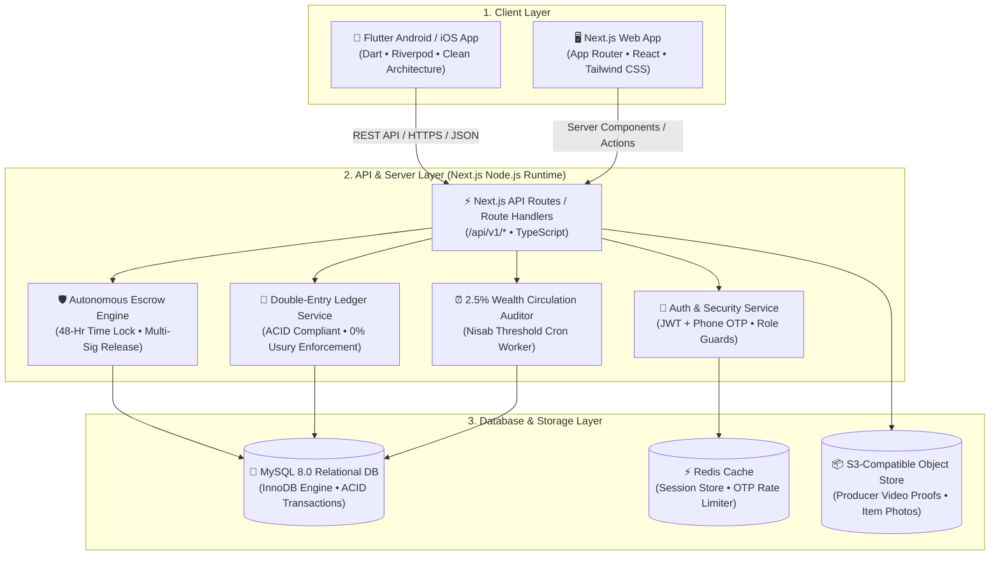

# FairCircle — Full System Architecture
### Flutter Android Client + Next.js Fullstack Backend + MySQL Relational Database

---

## 1. High-Level Architecture Overview



---

## 2. Complete MySQL Relational Database Schema (DDL)

The database enforces **double-entry bookkeeping**, **strict non-negative balances**, **zero interest**, and **atomic escrow locks** using MySQL InnoDB.

```sql
-- Database Initialization
CREATE DATABASE IF NOT EXISTS faircircle_db
  CHARACTER SET utf8mb4
  COLLATE utf8mb4_unicode_ci;

USE faircircle_db;

-- 1. Users Table
CREATE TABLE users (
    id VARCHAR(36) PRIMARY KEY,
    phone_number VARCHAR(20) NOT NULL UNIQUE,
    full_name VARCHAR(100) NOT NULL,
    avatar_url VARCHAR(255),
    role ENUM('CITIZEN', 'PRODUCER', 'STAKEHOLDER', 'ADMIN') NOT NULL DEFAULT 'CITIZEN',
    nid_verified BOOLEAN NOT NULL DEFAULT FALSE,
    reputation_score DECIMAL(5,2) NOT NULL DEFAULT 100.00,
    created_at TIMESTAMP DEFAULT CURRENT_TIMESTAMP,
    updated_at TIMESTAMP DEFAULT CURRENT_TIMESTAMP ON UPDATE CURRENT_TIMESTAMP,
    INDEX idx_user_phone (phone_number),
    INDEX idx_user_role (role)
) ENGINE=InnoDB;

-- 2. User Wallets (100% Real-Asset Backed, Zero Debt/Overdraft)
CREATE TABLE wallets (
    id VARCHAR(36) PRIMARY KEY,
    user_id VARCHAR(36) NOT NULL UNIQUE,
    available_balance DECIMAL(14,2) NOT NULL DEFAULT 0.00 CHECK (available_balance >= 0.00),
    locked_escrow_balance DECIMAL(14,2) NOT NULL DEFAULT 0.00 CHECK (locked_escrow_balance >= 0.00),
    currency VARCHAR(10) NOT NULL DEFAULT 'BDT',
    created_at TIMESTAMP DEFAULT CURRENT_TIMESTAMP,
    updated_at TIMESTAMP DEFAULT CURRENT_TIMESTAMP ON UPDATE CURRENT_TIMESTAMP,
    FOREIGN KEY (user_id) REFERENCES users(id) ON DELETE RESTRICT
) ENGINE=InnoDB;

-- 3. Double-Entry Immutable Financial Ledger
-- Prohibits any compound interest or fictitious money creation
CREATE TABLE ledger_transactions (
    id VARCHAR(36) PRIMARY KEY,
    from_wallet_id VARCHAR(36),
    to_wallet_id VARCHAR(36),
    amount DECIMAL(14,2) NOT NULL CHECK (amount > 0.00),
    interest_amount DECIMAL(14,2) NOT NULL DEFAULT 0.00 CHECK (interest_amount = 0.00), -- Strictly 0.00 enforced
    transaction_type ENUM('WALLET_DEPOSIT', 'ESCROW_LOCK', 'ESCROW_RELEASE', 'PREORDER_INVEST', 'QARD_HASAN_LEND', 'QARD_HASAN_REPAY', 'CIRCULATION_DUTY') NOT NULL,
    reference_id VARCHAR(36),
    notes VARCHAR(255),
    created_at TIMESTAMP DEFAULT CURRENT_TIMESTAMP,
    FOREIGN KEY (from_wallet_id) REFERENCES wallets(id),
    FOREIGN KEY (to_wallet_id) REFERENCES wallets(id),
    INDEX idx_ledger_type (transaction_type),
    INDEX idx_ledger_ref (reference_id)
) ENGINE=InnoDB;

-- 4. Marketplace Products (B2C / Producer Storefront)
CREATE TABLE products (
    id VARCHAR(36) PRIMARY KEY,
    producer_id VARCHAR(36) NOT NULL,
    title VARCHAR(200) NOT NULL,
    description TEXT NOT NULL,
    category ENUM('FOOD_AGRO', 'HANDLOOM_APPAREL', 'WOOD_CRAFT', 'HEALTH_CLINIC', 'HOUSEHOLD') NOT NULL,
    total_price DECIMAL(10,2) NOT NULL CHECK (total_price > 0),
    
    -- Mandatory 100% Transparent Price Breakdown
    raw_material_cost DECIMAL(10,2) NOT NULL CHECK (raw_material_cost >= 0),
    labor_wage_cost DECIMAL(10,2) NOT NULL CHECK (labor_wage_cost >= 0),
    packaging_transport_cost DECIMAL(10,2) NOT NULL DEFAULT 0.00,
    fair_profit_margin DECIMAL(10,2) NOT NULL CHECK (fair_profit_margin >= 0),
    
    stock_quantity INT NOT NULL DEFAULT 1,
    inspection_period_hours INT NOT NULL DEFAULT 48,
    is_active BOOLEAN NOT NULL DEFAULT TRUE,
    created_at TIMESTAMP DEFAULT CURRENT_TIMESTAMP,
    FOREIGN KEY (producer_id) REFERENCES users(id),
    INDEX idx_prod_cat (category),
    INDEX idx_prod_active (is_active)
) ENGINE=InnoDB;

-- 5. Autonomous 48-Hour Escrow Orders
CREATE TABLE escrow_orders (
    id VARCHAR(36) PRIMARY KEY,
    buyer_id VARCHAR(36) NOT NULL,
    producer_id VARCHAR(36) NOT NULL,
    product_id VARCHAR(36) NOT NULL,
    order_amount DECIMAL(12,2) NOT NULL,
    status ENUM('FUNDS_LOCKED', 'DISPATCHED_PROOF_UPLOADED', 'DELIVERED_INSPECTING', 'SATISFIED_RELEASED', 'DISPUTED_RESOLVING', 'REFUNDED') NOT NULL DEFAULT 'FUNDS_LOCKED',
    seller_dispatch_video_url VARCHAR(255),
    inspection_deadline TIMESTAMP NULL,
    buyer_feedback_satisfaction BOOLEAN,
    created_at TIMESTAMP DEFAULT CURRENT_TIMESTAMP,
    updated_at TIMESTAMP DEFAULT CURRENT_TIMESTAMP ON UPDATE CURRENT_TIMESTAMP,
    FOREIGN KEY (buyer_id) REFERENCES users(id),
    FOREIGN KEY (producer_id) REFERENCES users(id),
    FOREIGN KEY (product_id) REFERENCES products(id),
    INDEX idx_escrow_status (status)
) ENGINE=InnoDB;

-- 6. Forward Production / Harvest Pre-Order Campaigns (C2B / Salam Model)
CREATE TABLE preorder_campaigns (
    id VARCHAR(36) PRIMARY KEY,
    producer_id VARCHAR(36) NOT NULL,
    title VARCHAR(200) NOT NULL,
    description TEXT NOT NULL,
    target_amount DECIMAL(14,2) NOT NULL CHECK (target_amount > 0),
    current_funded_amount DECIMAL(14,2) NOT NULL DEFAULT 0.00,
    share_price DECIMAL(10,2) NOT NULL CHECK (share_price > 0),
    total_shares INT NOT NULL,
    sold_shares INT NOT NULL DEFAULT 0,
    unit_return_yield VARCHAR(100) NOT NULL, -- e.g. '25kg Organic Aromatic Rice'
    estimated_retail_value DECIMAL(10,2) NOT NULL,
    harvest_delivery_date DATE NOT NULL,
    status ENUM('FUNDING_ACTIVE', 'TARGET_REACHED', 'IN_PRODUCTION', 'HARVEST_DELIVERED', 'COMPLETED') NOT NULL DEFAULT 'FUNDING_ACTIVE',
    created_at TIMESTAMP DEFAULT CURRENT_TIMESTAMP,
    FOREIGN KEY (producer_id) REFERENCES users(id)
) ENGINE=InnoDB;

-- 7. Pre-Order Buyer Shares (Salam Forward Contract Holders)
CREATE TABLE preorder_shares (
    id VARCHAR(36) PRIMARY KEY,
    campaign_id VARCHAR(36) NOT NULL,
    user_id VARCHAR(36) NOT NULL,
    shares_count INT NOT NULL DEFAULT 1,
    total_amount_paid DECIMAL(12,2) NOT NULL,
    is_yield_delivered BOOLEAN NOT NULL DEFAULT FALSE,
    created_at TIMESTAMP DEFAULT CURRENT_TIMESTAMP,
    FOREIGN KEY (campaign_id) REFERENCES preorder_campaigns(id),
    FOREIGN KEY (user_id) REFERENCES users(id)
) ENGINE=InnoDB;

-- 8. 0% Interest Benevolent Loan Pools (Qard Hasan)
CREATE TABLE qard_hasan_pools (
    id VARCHAR(36) PRIMARY KEY,
    name VARCHAR(150) NOT NULL,
    area_district VARCHAR(100) NOT NULL,
    total_reserve_pool DECIMAL(14,2) NOT NULL DEFAULT 0.00,
    currently_lent_out DECIMAL(14,2) NOT NULL DEFAULT 0.00,
    interest_rate DECIMAL(4,2) NOT NULL DEFAULT 0.00 CHECK (interest_rate = 0.00), -- Strictly 0.00
    late_penalty_rate DECIMAL(4,2) NOT NULL DEFAULT 0.00 CHECK (late_penalty_rate = 0.00), -- Strictly 0.00
    created_at TIMESTAMP DEFAULT CURRENT_TIMESTAMP
) ENGINE=InnoDB;

-- 9. Benevolent Emergency Loans (0% Interest)
CREATE TABLE qard_hasan_loans (
    id VARCHAR(36) PRIMARY KEY,
    pool_id VARCHAR(36) NOT NULL,
    borrower_id VARCHAR(36) NOT NULL,
    principal_amount DECIMAL(10,2) NOT NULL CHECK (principal_amount > 0),
    repaid_amount DECIMAL(10,2) NOT NULL DEFAULT 0.00,
    total_due DECIMAL(10,2) GENERATED ALWAYS AS (principal_amount) STORED, -- Always equals principal exactly!
    installment_months INT NOT NULL DEFAULT 6,
    purpose TEXT NOT NULL,
    status ENUM('REQUESTED', 'APPROVED_DISBURSED', 'ACTIVE_REPAYING', 'FULLY_REPAID', 'HARDSHIP_EXTENDED') NOT NULL DEFAULT 'REQUESTED',
    created_at TIMESTAMP DEFAULT CURRENT_TIMESTAMP,
    FOREIGN KEY (pool_id) REFERENCES qard_hasan_pools(id),
    FOREIGN KEY (borrower_id) REFERENCES users(id)
) ENGINE=InnoDB;

-- 10. Community Tool & Machinery Library (C2C Sharing)
CREATE TABLE tool_shares (
    id VARCHAR(36) PRIMARY KEY,
    owner_id VARCHAR(36) NOT NULL,
    title VARCHAR(150) NOT NULL,
    category VARCHAR(80) NOT NULL,
    security_deposit DECIMAL(10,2) NOT NULL DEFAULT 0.00,
    fuel_maintenance_fee DECIMAL(10,2) NOT NULL DEFAULT 0.00,
    status ENUM('AVAILABLE', 'IN_USE', 'MAINTENANCE') NOT NULL DEFAULT 'AVAILABLE',
    created_at TIMESTAMP DEFAULT CURRENT_TIMESTAMP,
    FOREIGN KEY (owner_id) REFERENCES users(id)
) ENGINE=InnoDB;

-- 11. User Self-Regulation Financial Profiles
CREATE TABLE user_financial_profiles (
    user_id VARCHAR(36) PRIMARY KEY,
    monthly_net_income DECIMAL(12,2) NOT NULL DEFAULT 0.00,
    shield_percentage INT NOT NULL DEFAULT 40,
    active_usury_debt DECIMAL(12,2) NOT NULL DEFAULT 0.00,
    idle_stagnant_savings DECIMAL(14,2) NOT NULL DEFAULT 0.00,
    mutual_aid_given_annual DECIMAL(12,2) NOT NULL DEFAULT 0.00,
    conscience_score INT NOT NULL DEFAULT 100,
    last_zakat_calculated_at TIMESTAMP NULL,
    updated_at TIMESTAMP DEFAULT CURRENT_TIMESTAMP ON UPDATE CURRENT_TIMESTAMP,
    FOREIGN KEY (user_id) REFERENCES users(id)
) ENGINE=InnoDB;
```

---

## 3. Next.js Fullstack Backend Architecture

### Directory Layout (`/backend-web`)
```
backend-web/
├── src/
│   ├── app/
│   │   ├── (auth)/login/page.tsx
│   │   ├── (dashboard)/
│   │   │   ├── marketplace/page.tsx
│   │   │   ├── invest/page.tsx
│   │   │   ├── mutual-aid/page.tsx
│   │   │   └── health/page.tsx
│   │   ├── api/v1/
│   │   │   ├── auth/route.ts
│   │   │   ├── marketplace/
│   │   │   │   ├── products/route.ts
│   │   │   │   └── [id]/route.ts
│   │   │   ├── escrow/
│   │   │   │   ├── create/route.ts
│   │   │   │   ├── dispatch/route.ts
│   │   │   │   ├── release/route.ts
│   │   │   │   └── dispute/route.ts
│   │   │   ├── invest/
│   │   │   │   ├── campaigns/route.ts
│   │   │   │   └── preorder/route.ts
│   │   │   ├── qard/
│   │   │   │   ├── pools/route.ts
│   │   │   │   └── apply-loan/route.ts
│   │   │   └── health-calculator/
│   │   │       ├── evaluate/route.ts
│   │   │       └── apply-shield/route.ts
│   │   ├── layout.tsx
│   │   └── page.tsx
│   ├── lib/
│   │   ├── db.ts              # MySQL connection pool (mysql2/promise or Prisma)
│   │   ├── jwt.ts             # JWT token issuance and verification
│   │   └── validators.ts      # Zod validation schemas
│   ├── services/
│   │   ├── escrow.service.ts  # Autonomous 48-hr state machine
│   │   ├── ledger.service.ts  # ACID double-entry transaction runner
│   │   └── circulation.service.ts # 2.5% wealth auditor
│   └── cron/
│       └── circulation-worker.ts # Periodic Nisab check
```

### Core Escrow API Implementation Sample (`src/services/escrow.service.ts`)
```typescript
import pool from '@/lib/db';
import { v4 as uuidv4 } from 'uuid';

export class EscrowService {
  /**
   * Locks buyer funds into secure escrow inside an atomic MySQL transaction
   */
  static async lockBuyerFunds(buyerId: string, productId: string, amount: number) {
    const connection = await pool.getConnection();
    await connection.beginTransaction();

    try {
      // 1. Check buyer available balance
      const [walletRows]: any = await connection.query(
        'SELECT id, available_balance FROM wallets WHERE user_id = ? FOR UPDATE',
        [buyerId]
      );
      const buyerWallet = walletRows[0];
      if (!buyerWallet || buyerWallet.available_balance < amount) {
        throw new Error('অপর্যাপ্ত ব্যালেন্স: পর্যাপ্ত ফান্ড নেই');
      }

      // 2. Fetch product and producer
      const [prodRows]: any = await connection.query(
        'SELECT producer_id FROM products WHERE id = ? AND is_active = 1',
        [productId]
      );
      const product = prodRows[0];
      if (!product) throw new Error('পণ্য পাওয়া যায়নি');

      // 3. Move funds from available to locked_escrow
      await connection.query(
        'UPDATE wallets SET available_balance = available_balance - ?, locked_escrow_balance = locked_escrow_balance + ? WHERE id = ?',
        [amount, amount, buyerWallet.id]
      );

      // 4. Create Escrow Order record
      const escrowId = uuidv4();
      await connection.query(
        `INSERT INTO escrow_orders (id, buyer_id, producer_id, product_id, order_amount, status)
         VALUES (?, ?, ?, ?, ?, 'FUNDS_LOCKED')`,
        [escrowId, buyerId, product.producer_id, amount]
      );

      // 5. Append ledger record (zero interest guaranteed)
      const ledgerId = uuidv4();
      await connection.query(
        `INSERT INTO ledger_transactions (id, from_wallet_id, to_wallet_id, amount, interest_amount, transaction_type, reference_id, notes)
         VALUES (?, ?, NULL, ?, 0.00, 'ESCROW_LOCK', ?, 'Buyer locked funds for physical inspection')`,
        [ledgerId, buyerWallet.id, amount, escrowId]
      );

      await connection.commit();
      return { success: true, escrowId };
    } catch (error) {
      await connection.rollback();
      throw error;
    } finally {
      connection.release();
    }
  }

  /**
   * Releases locked escrow to the producer when the 48-hr inspection is satisfied
   */
  static async releaseFunds(escrowId: string, buyerId: string) {
    const connection = await pool.getConnection();
    await connection.beginTransaction();

    try {
      // 1. Fetch escrow order
      const [escrowRows]: any = await connection.query(
        'SELECT * FROM escrow_orders WHERE id = ? AND buyer_id = ? FOR UPDATE',
        [escrowId, buyerId]
      );
      const escrow = escrowRows[0];
      if (!escrow || escrow.status === 'SATISFIED_RELEASED') {
        throw new Error('অবৈধ বা ইতিমধ্যে নিষ্পত্তি করা অর্ডার');
      }

      // 2. Fetch producer wallet
      const [sellerWalletRows]: any = await connection.query(
        'SELECT id FROM wallets WHERE user_id = ? FOR UPDATE',
        [escrow.producer_id]
      );
      const sellerWallet = sellerWalletRows[0];

      // 3. Fetch buyer wallet
      const [buyerWalletRows]: any = await connection.query(
        'SELECT id FROM wallets WHERE user_id = ? FOR UPDATE',
        [buyerId]
      );
      const buyerWallet = buyerWalletRows[0];

      // 4. Transfer locked balance to producer's available balance
      await connection.query(
        'UPDATE wallets SET locked_escrow_balance = locked_escrow_balance - ? WHERE id = ?',
        [escrow.order_amount, buyerWallet.id]
      );
      await connection.query(
        'UPDATE wallets SET available_balance = available_balance + ? WHERE id = ?',
        [escrow.order_amount, sellerWallet.id]
      );

      // 5. Update escrow status
      await connection.query(
        "UPDATE escrow_orders SET status = 'SATISFIED_RELEASED', buyer_feedback_satisfaction = 1 WHERE id = ?",
        [escrowId]
      );

      // 6. Record release in immutable ledger
      const ledgerId = uuidv4();
      await connection.query(
        `INSERT INTO ledger_transactions (id, from_wallet_id, to_wallet_id, amount, interest_amount, transaction_type, reference_id, notes)
         VALUES (?, ?, ?, ?, 0.00, 'ESCROW_RELEASE', ?, 'Buyer satisfied; funds released to producer')`,
        [ledgerId, buyerWallet.id, sellerWallet.id, escrow.order_amount, escrowId]
      );

      await connection.commit();
      return { success: true };
    } catch (error) {
      await connection.rollback();
      throw error;
    } finally {
      connection.release();
    }
  }
}
```

---

## 4. Flutter Android App Architecture

The Flutter client uses a **Feature-First Clean Architecture** with **Riverpod 2.0** for state management and **Dio** for network operations.

### Directory Structure (`/flutter_app`)
```
flutter_app/
├── lib/
│   ├── core/
│   │   ├── constants/
│   │   │   ├── app_colors.dart       # White, Slate, Emerald Green
│   │   │   └── api_endpoints.dart
│   │   ├── network/
│   │   │   ├── dio_client.dart       # Auth interceptor, retry logic
│   │   │   └── api_response.dart
│   │   ├── theme/
│   │   │   └── app_theme.dart        # Material 3 light theme (Plus Jakarta Sans)
│   │   └── utils/
│   │       └── currency_formatter.dart # BDT '৳' formatting
│   ├── features/
│   │   ├── auth/
│   │   │   ├── data/auth_repository.dart
│   │   │   ├── domain/user_model.dart
│   │   │   └── presentation/login_screen.dart
│   │   ├── marketplace/
│   │   │   ├── data/marketplace_repository.dart
│   │   │   ├── domain/product_model.dart
│   │   │   └── presentation/
│   │   │       ├── marketplace_screen.dart
│   │   │       └── product_detail_screen.dart # With transparent cost sheet
│   │   ├── invest_preorder/
│   │   │   ├── domain/campaign_model.dart
│   │   │   └── presentation/campaign_list_screen.dart
│   │   ├── mutual_aid/
│   │   │   ├── domain/qard_model.dart
│   │   │   └── presentation/
│   │   │       ├── qard_pool_screen.dart
│   │   │       └── tool_library_screen.dart
│   │   └── financial_health/
│   │       ├── domain/financial_health_state.dart
│   │       ├── presentation/
│   │       │   ├── health_dashboard_screen.dart
│   │       │   └── widgets/score_radial_badge.dart
│   ├── app.dart                      # MaterialApp.router with GoRouter
│   └── main.dart                     # ProviderScope entry point
```

### Flutter Riverpod State Controller Sample (`financial_health_controller.dart`)
```dart
import 'package:flutter_riverpod/flutter_riverpod.dart';

class FinancialHealthState {
  final double monthlySalary;
  final int shieldPercentage;
  final double usuryDebt;
  final double idleSavings;
  final double aidGiven;
  final int conscienceScore;
  final double circulationDuty;

  FinancialHealthState({
    required this.monthlySalary,
    required this.shieldPercentage,
    required this.usuryDebt,
    required this.idleSavings,
    required this.aidGiven,
    required this.conscienceScore,
    required this.circulationDuty,
  });

  factory FinancialHealthState.initial() {
    return FinancialHealthState(
      monthlySalary: 45000.0,
      shieldPercentage: 40,
      usuryDebt: 25000.0,
      idleSavings: 850000.0,
      aidGiven: 10000.0,
      conscienceScore: 65,
      circulationDuty: 21250.0,
    );
  }

  FinancialHealthState copyWith({
    double? monthlySalary,
    int? shieldPercentage,
    double? usuryDebt,
    double? idleSavings,
    double? aidGiven,
  }) {
    final s = monthlySalary ?? this.monthlySalary;
    final sp = shieldPercentage ?? this.shieldPercentage;
    final d = usuryDebt ?? this.usuryDebt;
    final i = idleSavings ?? this.idleSavings;
    final a = aidGiven ?? this.aidGiven;

    // Circulation Duty (Nisab threshold ~ 780,000 BDT)
    double duty = 0.0;
    if (i > 780000.0) {
      duty = i * 0.025;
    }
    final remainingBalance = (duty - a).clamp(0.0, double.infinity);

    // Conscience Score (Base 100)
    int score = 100;
    score -= ((d / 5000.0) * 5).clamp(0, 45).toInt();
    if (sp < 30) score -= (30 - sp);
    if (remainingBalance > 0) {
      score -= ((remainingBalance / 5000.0) * 2).clamp(0, 20).toInt();
    }
    if (a > duty && duty > 0) score += 5;
    score = score.clamp(10, 100);

    return FinancialHealthState(
      monthlySalary: s,
      shieldPercentage: sp,
      usuryDebt: d,
      idleSavings: i,
      aidGiven: a,
      conscienceScore: score,
      circulationDuty: duty,
    );
  }
}

class FinancialHealthNotifier extends StateNotifier<FinancialHealthState> {
  FinancialHealthNotifier() : super(FinancialHealthState.initial());

  void updateSalary(double val) => state = state.copyWith(monthlySalary: val);
  void updateShieldPct(int val) => state = state.copyWith(shieldPercentage: val);
  void updateDebt(double val) => state = state.copyWith(usuryDebt: val);
  void updateIdleSavings(double val) => state = state.copyWith(idleSavings: val);
  void updateAidGiven(double val) => state = state.copyWith(aidGiven: val);
}

final financialHealthProvider =
    StateNotifierProvider<FinancialHealthNotifier, FinancialHealthState>(
  (ref) => FinancialHealthNotifier(),
);
```

---

## 5. Security & Invariant Rules
1. **0% Interest Invariant:** `interest_amount` is hard-checked to `0.00` in both DB check constraints and service-level validations.
2. **Double-Entry Balance Preservation:** Sum of all ledger debits must equal credits at all times.
3. **No Unbacked Fiat Generation:** A wallet cannot borrow into negative numbers.
4. **48-Hour Escrow Protection:** Money cannot be collected by a producer until the physical inspection timer completes or the buyer signals satisfaction.
